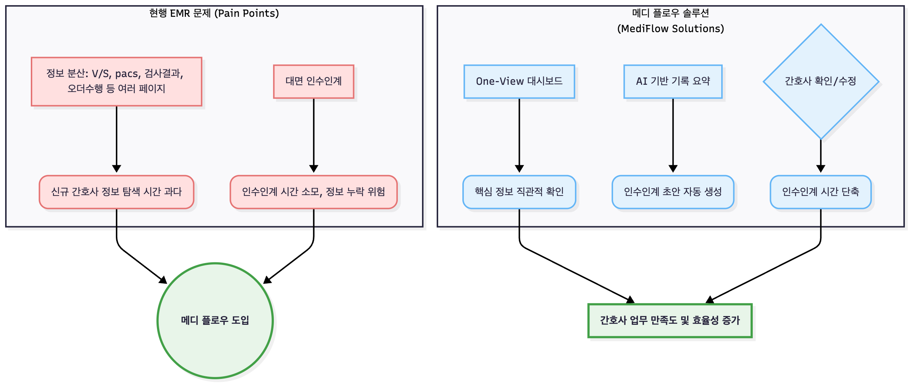

# 프로젝트 개요 (Project Overview)

## 현재 구현 상태 (2026-10-11)

- 랜딩·로그인·메인·상세 화면은 라이트 기본값의 저장형 다크모드를 제공합니다. 데스크톱 가로형 배치를 유지하고 작은 화면의 일부 세로 배치, 버튼 줄바꿈 방지, 공통 포커스·움직임과 reduced-motion을 적용했습니다.
- 담당·전체 환자는 이름/환자번호/진단·병실·알레르기·낙상·격리, 간호기록은 내용·기간·카테고리·작성자·중요 여부로 필터링합니다. 인수인계는 내용/작성자·기간·근무조·수기/AI·상태를 필터링합니다. 필터는 조회된 목록에 클라이언트에서 적용합니다.
- 수기·AI 초안을 서버에 임시저장하고 다시 열어 수정·승인합니다. 승인 후 작성자 수정도 가능하며 원본 AI와 수정본, 버전별 스냅샷을 보존합니다. 초안은 작성자 전용, 승인본·이력은 같은 부서 조회입니다.
- 운영 배포는 Flyway 마이그레이션 → Hibernate validate → 건강 상태 확인 순서입니다. 기존 DB의 최초 기준선 등록·백업·실패 대응은 저장소 `deploy/database/README.md`를 따릅니다. 기존 MariaDB를 보존하는 로컬 실행은 `local` 프로필입니다.
- 최신 API는 저장소 `swagger.yaml` 1.3.0, DB 개요는 `assets/db.png`입니다. 소개 GIF는 2026.10.11 현재 UI 기준입니다. 설계 개념 그림의 후속 기능은 구현 범위와 구분해서 확인하세요.

## 핵심 요약

**MediFlow**는 간호사의 실무 경험을 기반으로 설계한 병동 간호·인수인계 EMR 연계 모듈입니다. 병원 전체 EMR을 대체하기보다 기존 EMR/OCS 위에서 분산된 환자정보를 통합 조회하고 인수인계 초안을 생성하는 업무 흐름을 검증합니다.

- **개발 인원**: 1인 (Full-stack)
- **핵심 가치**: 도메인 전문성을 기술로 전환한 문제 해결
- **현재 단계**: 가상 환자 데이터만 사용하는 포트폴리오 PoC
- **인증 상태**: 전자의무기록시스템 인증 제품이 아님

---

## 프로젝트 목표 구조

---

## 프로젝트 배경

### 현장에서 발견한 문제

간호사로 근무하며 경험한 EMR 시스템의 핵심 문제점:

#### 1. 분산된 정보 구조로 인한 시간 낭비
- 환자 한 명의 상태 파악을 위해 **활력징후, I/O, 투약기록, 간호기록, 검사결과** 등 최소 5개 이상의 페이지를 이동해야 함
- 신규 간호사는 정보 위치를 몰라 **환자 상태 파악에 과도한 시간 소요**
- 응급 상황에서 빠른 의사결정에 치명적인 장애 요소

#### 2. 비효율적인 인수인계 프로세스
- 대면 인수인계로 인한 **시간 소모** 및 **정보 누락 위험**
- 간호사가 당일 근무 내용을 수기로 정리하여 구두 전달
- 표준화되지 않은 인수인계 방식으로 일관성 부족

### 기술적 해결 방안

| 문제 영역 | 기존 방식             | 메디 플로우 솔루션 | 기술적 구현 |
|---------|-------------------|----------------|-----------|
| **정보 조회** | 다중 페이지 이동 (5+ 클릭) | One-View 통합 대시보드 | React 컴포넌트 모듈화 + 실시간 데이터 aggregation |
| **인수인계** | 수기 작성 + 구두 전달     | 수기·AI 초안 임시저장·수정·승인 | Gemini API 활용한 의료 기록 요약 파이프라인 |
| **신규 간호사 적응** | 별도 교육 필요          | 직관적 UI/UX | 간호 업무 플로우 기반 정보 아키텍처 설계 |

---

## 도메인 전문성의 기술적 전환

### 간호사 경험 → 데이터 모델링
- **실무 지식**: 환자 상태 파악에 필요한 핵심 데이터 우선순위 파악
- **기술 적용**: 8개 부서별 환자-간호사 배치 로직, ER부서 Triage 레벨 기반 데이터 구조 설계
- **결과**: Patient, Nurse, Department 엔티티 간 다대다 관계 설계로 유연한 배치 관리 구현

### 인수인계 프로세스 이해 → AI 프롬프트 엔지니어링
- **실무 지식**: 인수인계 시 전달되어야 할 필수 정보 항목 정의 (활력징후 변화, 투약 이력, 특이사항 등)
- **기술 적용**: 의료 기록 데이터를 구조화하여 Gemini API에 전달, 간호사 검토 가능한 요약문 생성
- **결과**: AI가 초안 작성 → 간호사 검토/수정 → 저장/공유 파이프라인 구축

### 의료 규정 이해 → 보안 아키텍처 설계
- **실무 지식**: 의료법상 환자 정보 보호 규정 및 AI 활용 제약 사항 인지
- **기술 적용**: OAuth2 인증, 병원 자체 AI 서버 구축 시나리오 문서화
- **결과**: 실서비스 배포 시 고려사항 사전 정리 (→ 문서 8번 항목 참조)

---

## 프로젝트 정보

- **프로젝트 이름**: 메디플로우 (MediFlow)
- **배포 URL**:
    - Frontend: `https://mediflow-emr.cloud`
    - Backend API: `https://api.mediflow-emr.cloud`
    - API 문서: [api 명세서](6.API_DOCUMENTATION.md)
- **참고 문서**:
    - [기능 명세서](3.FEATURES.md)
    - [아키텍처 설계](4.ARCHITECTURE.md)
    - [의료법과 AI](8.LEGAL_COMPLIANCE.md)
    - [향후 업데이트 계획](7.ROADMAP.md)
