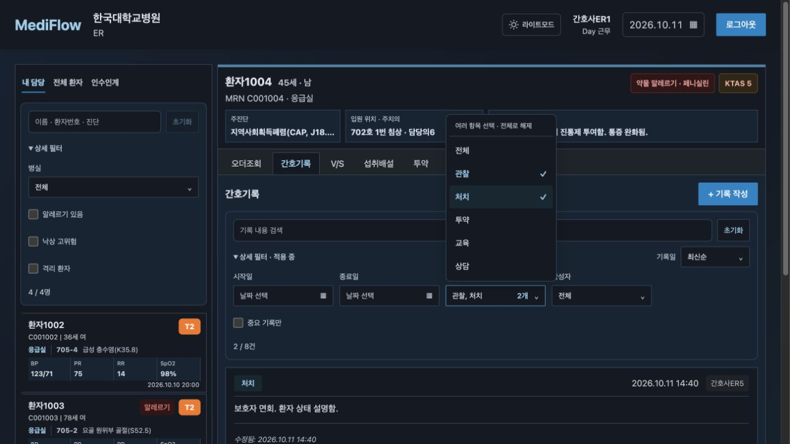
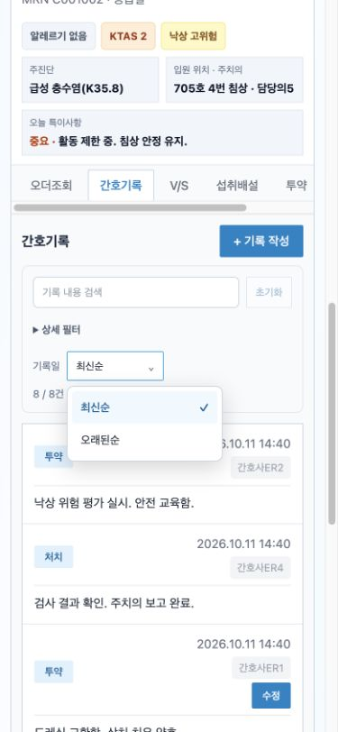
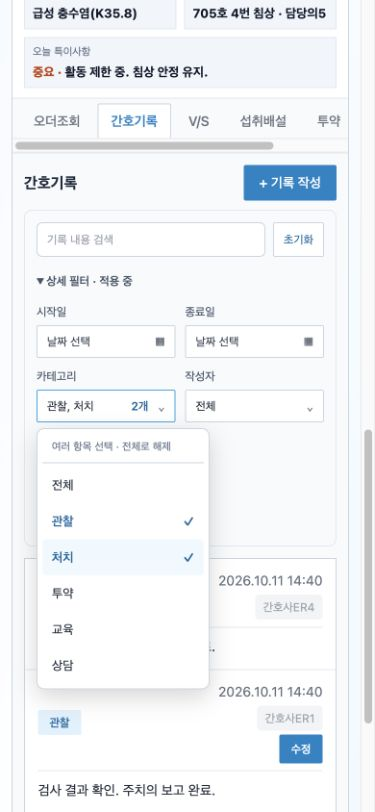
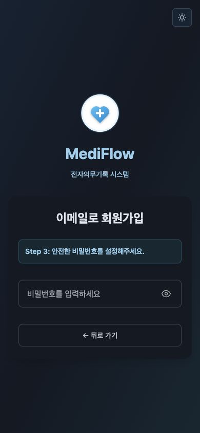
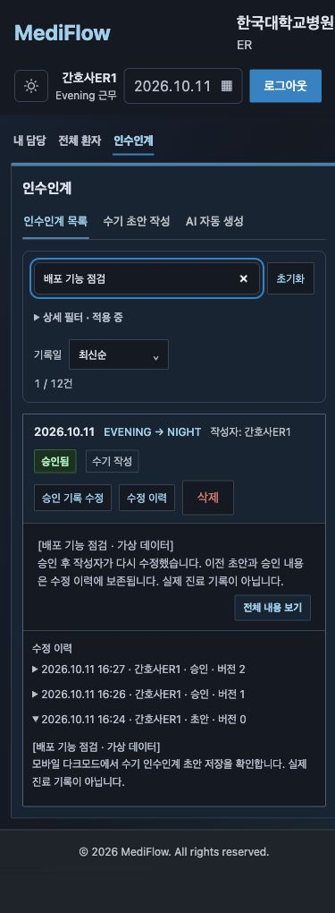
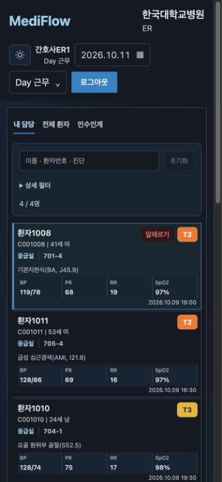

# 품질 보완과 검증 기록

2026-10-11 로컬 및 배포 사이트 점검 기준입니다. 가상 환자 데이터로 기존 기능의 저장·조회·권한·입력 검증·오류 복구를 보완했습니다. 운영 가상 데모 점검 결과는 아래에 별도로 기록하며 실제 병원 업무 검증은 포함하지 않습니다.

## 날짜 정렬

| 기능 | 정렬 기준 |
|---|---|
| 간호기록 | 작성 시각 |
| 인수인계 | 인수인계 날짜, 누락 시 생성 시각 |
| 오더 | 처방 시각 |
| 투약 | 수행 시각 |
| V/S | 측정 시각 |
| 섭취배설 | 기록 시각 |
| 검사결과 | 결과 시각, 누락 시 검사 시각 |

7개 기록 조회 API가 모두 날짜 내림차순을 사용하므로 기본값은 최신순입니다. 같은 인수인계 날짜에는 생성 시각을 보조 기준으로 적용합니다. 최신순·오래된순은 원본 배열을 변경하지 않으며 같은 날짜·시각의 순서를 유지합니다. 날짜 누락은 마지막에 표시합니다. 병원 LocalDateTime은 Asia/Seoul 기준으로 해석합니다. 차트와 V/S 증감 계산은 선택한 목록 순서에 영향을 받지 않습니다.

## UI와 코드 구조

- DatePicker·CustomSelect·DateTimePicker를 공통 테마, 포커스, 키보드 탐색과 팝오버 위치 규칙으로 통일했습니다.
- 병실·카테고리·작성자·근무조·작성 방식·상태의 다중 선택은 필드 내부 OR, 필드 사이 AND로 결합합니다. 선택 수를 표시하고 전체를 선택하면 해당 제한을 해제합니다.
- 상세 필터 접기, 적용 표시, 건수, 초기화, 결과 없음 상태를 사용합니다. 초기화는 정렬도 최신순으로 복원합니다.
- useRecordList는 이전 GET 취소·로딩·실패·재조회를 담당합니다. 환자별 폼을 분리하고 로그아웃·인증 만료 시 대시보드 상태와 조회를 초기화합니다.
- 미저장 이동 확인은 공통 모달이며 취소 시 입력을 유지합니다. 저장·생성 중에는 화면 이동을 막습니다. 창 닫기·새로고침에는 브라우저 미저장 확인을 사용합니다.
- 약품 문서 표현을 DrugDocument로 분리했습니다. 사용하지 않는 개발 페이지, 변경 전후를 설명하는 긴 튜토리얼 주석, 인증·임상 응답 디버그 출력을 정리했습니다.
- 미사용 Tailwind·STOMP·Markdown 관련 직접 의존성을 제거하고 호환 가능한 보안 패치를 적용했습니다. CSS Modules/SCSS를 유지하며 라우트·차트 번들을 분리했습니다.

## 저장과 접근 제어

간호기록·V/S·I/O 수정은 요청 환자, 작성자, 현재 부서 접근 권한과 version을 검증합니다. 누락·오래된 버전과 동시 수정은 409로 반환하고 폼은 유지합니다. 저장 후 갱신된 버전을 응답합니다. V/S·I/O 빈 측정과 범위 오류, 오더 필수값·길이 오류는 거부합니다. I/O 0은 허용합니다.

오더 약품 상세 조회·삭제에 환자 접근 검사를 추가했습니다. 약품 조회를 취소하면 이전 응답이 새 약품 화면을 덮어쓰지 않게 처리하며 오더 상태 변경의 중복 요청을 막습니다. 잘못된 JSON·파라미터는 400, 권한 거부는 403으로 구분합니다. 인증 갱신은 동시에 한 번만 실행하고 각 요청은 한 번만 재시도합니다. 일반 쓰기의 네트워크·타임아웃 실패는 자동 재전송하지 않습니다.

간호기록 HTML은 DOMPurify로 활성 콘텐츠·이벤트·이미지·링크를 제거하고 편집기에서 쓰는 강조와 색상만 유지합니다. 붙여넣기는 일반 텍스트입니다. 투약은 원본 보존 정책상 직접 수정·삭제하지 않습니다.

## 검증 결과

| 확인 | 결과 |
|---|---|
| 프론트엔드 Node 테스트 | 23개 통과: 인증 갱신, HTML 보안, 날짜·정렬·필터·테마·초안 편집 |
| ESLint | 오류 0, 경고 0 |
| Vite 운영 빌드 | 성공, 라우트·차트 번들 분리 |
| Gradle 테스트 | 80개 통과: 권한·입력·저장 버전·인수인계 이력·쿠키·마이그레이션 등 |
| npm audit | 취약점 0건, 확인 시점 기준 |
| 로컬 브라우저 | 사용자 ID 보존과 작성자 수정 버튼, 수기 임시저장·재조회, AI 생성·수정·승인·승인 후 재수정·버전 이력, 가상 계정 로그인, 달력 선택, 정렬 키보드 조작, 미저장 이동 취소·입력 보존, 라이트·다크, 390px 필터·팝오버 확인 |

백엔드 통합 테스트는 별도 H2 메모리 DB를 사용하며 기존 MariaDB에 create를 적용하지 않습니다. 이전 작업에서 Flyway SQL은 임시 MariaDB 스키마에서도 확인했습니다. 현재 UI는 MariaDB의 다시 생성한 가상 데이터로 확인합니다. 기존 사용자 작성 데이터의 복구를 의미하지 않습니다.

```sh
npm --prefix frontend test
npm --prefix frontend run lint
npm --prefix frontend run build
cd frontend && npm audit
cd ../backend && bash gradlew test bootJar
```







## 검증 범위의 한계

인수인계는 스냅샷 수정 이력을 보존하지만 간호기록·V/S·I/O의 정정 전후 이력·전자서명은 아직 별도 구현이 필요합니다. 병원 연계, 담당 환자 단위 세부 권한, 운영 DB 백업 복원 훈련, 실제 환경 부하·임상 검증은 후속 범위입니다. 이번 자동 테스트는 이러한 운영·임상 검증을 대체하지 않습니다.

## 운영 배포 확인 (2026.10.11)

GitHub Actions의 [프런트엔드 배포](https://github.com/MediFlow-EMR/mediflow-dev/actions/runs/38120261719), [백엔드 배포](https://github.com/MediFlow-EMR/mediflow-dev/actions/runs/38120261698), [CI](https://github.com/MediFlow-EMR/mediflow-dev/actions/runs/38120261678)가 성공했습니다. 운영 가상 데모 계정의 로그인과 대시보드 조회를 브라우저에서 확인했습니다.

DB 압축 백업을 검증한 뒤 Flyway 20261011이 성공했고, 적용 전후 환자 146건·간호기록 909건·인수인계 41건이 동일했습니다. 최초 기준선 등록용 GitHub production 변수는 false로 돌렸습니다. DB 복원 훈련까지 수행했다는 의미는 아닙니다. 로그인 및 기존 소개 GIF 4종은 실제 로컬 브라우저 조작 화면으로 갱신했으며, 랜딩 GIF URL에 버전을 붙여 기존 브라우저 캐시에서도 새 자료를 받도록 합니다.

배포 도중 열려 있던 화면의 지연 로딩 오류를 확인하여, 프런트엔드 업로드에서 이전 번들 삭제를 제거하고 index.html을 마지막에 교체하도록 수정했습니다. 해시 번들 복원 워크플로도 추가했습니다.

## 배포 사이트 추가 점검

390px 모바일·다크모드에서 데모 로그인, 병실 2개 선택, 간호기록 카테고리 2개·작성자 2개·중요 여부 조합, 인수인계 검색·근무조 2개·커스텀 날짜 선택을 확인했습니다. 오더·V/S·섭취배설·투약·검사결과·인수인계의 실제 표시 날짜가 최신순/오래된순 선택에 따라 반전되는 것을 확인했습니다. 간호기록도 정렬 전환과 초기화 시 최신순 복원을 확인했습니다.

수기·AI 점검용 기록은 명시적으로 가상 데이터임을 표시했습니다. 초안 서버 저장·재조회, 승인, 작성자 재수정과 초안 0/승인 1/수정 2 버전 이력을 검증했습니다. 당일 기록이 없는 근무조는 AI 호출 없이 기록 없음 안내를 반환하며 수치를 만들지 않습니다.

이메일 중복 조회가 SMTP 발송에 의존하던 오류를 수정했습니다. 운영 SMTP 535 인증 거절을 확인해 비밀값을 별도 갱신했으며, 발송은 버튼 클릭의 POST 요청으로 분리했습니다. 자동 테스트는 조회의 무부작용, 소셜 계정 중복, 재발송 간격, SMTP 실패 롤백, 오입력 제한·재사용 방지·입력 검증을 포함합니다.

AI 인수인계의 과거 근무조 조회가 오늘 날짜를 사용하던 오류도 수정했습니다. 선택한 근무조 날짜로 전체·환자별 조회와 새 저장 날짜를 통일하고, 종료 경계를 제외하며 자정을 넘는 근무와 검사 결과 누락 시각을 테스트합니다. 기존 저장 기록 날짜는 소급 변경하지 않습니다.

## 이메일 복구와 최종 재배포

2026-10-11 운영 사이트에서 중복 확인 → 인증 메일 발송 → 실제 수신 → 사용자 제공 코드 검증 → 비밀번호 설정 화면 진입을 확인했습니다. 새 가입 비밀번호 입력·제출은 사용자가 직접 진행하도록 남겼으며, 실제 신규 계정 생성까지 완료했다고 주장하지 않습니다. 서버 자동 테스트는 가입 완료 검증과 SMTP 실패 시 트랜잭션 롤백을 포함합니다.

[프런트엔드 배포](https://github.com/MediFlow-EMR/mediflow-dev/actions/runs/38123151137), [백엔드 최종 배포](https://github.com/MediFlow-EMR/mediflow-dev/actions/runs/38122737450), [CI](https://github.com/MediFlow-EMR/mediflow-dev/actions/runs/38122737454)가 성공했습니다. 백엔드 테스트 80개와 프런트엔드 테스트 23개가 통과했습니다. 운영 헬스 체크와 재로그인·대시보드 조회도 정상입니다. Flyway 20261011.2 적용 전후 환자·간호기록·인수인계 건수를 확인했습니다.





과거 근무조 날짜·자정을 넘는 구간·검사 값 입력은 서버 테스트로 검증했습니다. 상단 날짜 선택이 표시만 바꾸던 동작을 수정해 조회 날짜·근무조를 담당 배정과 인수인계 생성·저장에 연결했습니다. 날짜를 빠르게 바꿀 때 이전 요청은 취소하고 이전 화면 내용도 지워 혼합 표시를 막습니다. 승인 기록은 원래 근무조로 수정합니다. 과거 환자 상태 스냅샷 복원은 포함하지 않습니다.

최종 운영 재점검에서 Evening 담당 2명과 Day 담당 4명 전환, 배정 없는 과거 날짜의 빈 상태, 모바일 다크모드 근무조 메뉴와 가로 넘침 여부, 미저장 전환 보호를 확인했습니다. Day를 조회하는 중 Evening 승인 기록을 열어도 편집 기준은 EVENING → NIGHT로 유지됩니다. AI 점검 기록의 초안 0/승인 1/수정 2 이력도 재확인했습니다.



소개 GIF 5종은 최종 배포 사이트의 실제 브라우저 화면으로 재촬영했습니다. 로그인, 날짜·근무조별 환자 전환, 간호기록 다중 카테고리, 오더 정렬·약품 조회, AI 초안 편집·미저장 보호·승인 이력을 보여줍니다. 이번 AI 영상의 근무에는 기록이 없어 외부 모델 호출 대신 기록 없음 안내가 사용되며, 이를 실제 AI 추론 실행으로 제시하지 않습니다.

인증 후 비밀번호 설정 중 유효 시간이 지나도 복구할 수 있도록 ‘이메일 다시 인증’ 버튼과 만료 오류 안내를 추가했습니다. 재인증은 기존 이메일을 유지하고 비밀번호를 초기화하며, 메일은 재발송 버튼을 명시적으로 눌러야 보냅니다.

## SMTP 임시 객체 정리 상태

2026-10-11 운영자가 S3 임시 파일과 모든 버전 삭제 완료를 보고했습니다. 이전 정리 워크플로는 객체 생성·덮어쓰기·삭제를 하지 않는 읽기 전용 버전 확인으로 대체했습니다. [독립 확인 실행](https://github.com/MediFlow-EMR/mediflow-dev/actions/runs/38123565546)은 버전 목록 조회 권한 제한으로 실패했으므로, 이 결과를 잔여 객체 0건의 증거로 사용하지 않습니다. CloudShell 버전·삭제 마커 조회 결과가 0인지 확인하는 절차는 [운영 가이드](https://github.com/MediFlow-EMR/mediflow-dev/blob/main/deploy/aws/README.md)에 기록했습니다. 운영 서버 헬스 체크와 기존 기능 배포·CI는 정상입니다.
